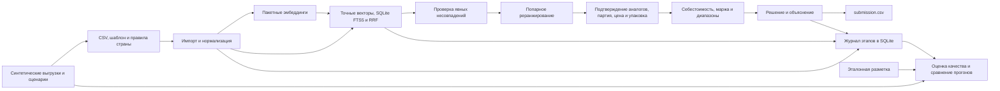

# Техническая архитектура

Прототип реализован на Rust. Обязательные правила и формат сдачи заданы в [бизнес-требованиях](business-requirements.md), [рабочих допущениях](risks-and-assumptions.md) и [критериях приёмки](acceptance-and-quality.md). Решения по реализации и проверкам собраны в [реестре ADR](adr/README.md).

## Схема



Один CLI координирует обработку и публикует результаты. После подготовки индексов карточки проходят через ограниченные очереди. Эмбеддинги запрашиваются пакетами. Число запросов к адаптерам инференса и поисковому индексу ограничено отдельно. Проверка предложений и экономика выполняются в фиксированном пуле Rayon. Порядок строк восстанавливается при выгрузке. [Параллельная обработка](adr/0011-workers.md)

## Модули

| Модуль | Ответственность | Основные готовые компоненты |
| --- | --- | --- |
| [app](adr/0001-application.md) | Команды, конфигурация, зависимости, публикация прогона | Rust, `clap`, `serde`, `toml` |
| [io](adr/0002-ingestion-output.md) | Профили входных CSV, ключи, выходной контракт | `csv`, `serde`, `tempfile` |
| [normalize](adr/0003-normalization.md) | Unicode, извлечение размеров, единиц и структурированных признаков | `unicode-normalization`, `regex`, `rust_decimal` |
| [embedding](adr/0004-embeddings.md) | Подготовка текстов, пакетные запросы и кеш | Многоязычные эмбеддинги, `reqwest` |
| [search](adr/0005-hybrid-search.md) | Векторные и лексические кандидаты, объединение и диагностика | SQLite FTS5, ndarray, BM25, RRF |
| [matching](adr/0006-match-verification.md) | Проверка идентичности модели и пригодности набора | Сигналы гибридного поиска, типизированные правила предметной области |
| [reranking](adr/0015-reranking.md) | Уточнение ранга короткого списка пар карточка–предложение | Попарная оценка через адаптер профиля |
| [procurement](adr/0007-procurement.md) | MOQ, фактическое количество, ступень цены и выбор предложения | `rust_decimal`, проверяемая целочисленная арифметика Rust |
| [logistics](adr/0008-logistics.md) | Приведение веса и объёма к единице карточки, проверка каталожных данных | Связь каталога по ID предложения, типизированные измерения |
| [economics](adr/0009-economics.md) | Формулы, ставки и гарантированные границы маржи | `rust_decimal`, проверяемые операции |
| [decision](adr/0010-decision.md) | Приоритет условий, ручная проверка, причина и уверенность | Типы Rust, таблицы решений |
| [workers](adr/0011-workers.md) | Ограничение параллелизма, пакетирование, отмена и сбор результатов | Rayon, ограниченные окна и один запрос реранжирования |
| [telemetry](adr/0012-telemetry.md) | События по этапам и карточкам, тайминги, происхождение данных | `rusqlite`, JSON и перцентили этапов |
| [evaluation](adr/0013-evaluation.md) | Метрики, сравнение прогонов и разбор ошибок | SQLite, `csv`, `serde_json` |
| [simulation](adr/0014-simulation.md) | Генерация выгрузок, сценарии и финансовые сравнения | Воспроизводимые SHA-256 выборки, `proptest`, общий конвейер |

## Границы ответственности

- **Поиск и решение о закупке.** Векторный поиск связывает описания на разных языках. BM25 по токенам и нормализованным признакам помогает сохранить серии, размеры и другие точные совпадения. Реранжирование уточняет порядок короткого списка, а поиск по подтверждённому ключу модели может вернуть дополнительные предложения. Финансовый расчёт сравнивает подтверждённые пригодные аналоги, включая кандидатов за пределами списка реранжирования. [ADR поиска](adr/0005-hybrid-search.md), [ADR реранжирования](adr/0015-reranking.md), [ADR закупки](adr/0007-procurement.md)
- **Подбор и финансовый расчёт.** Подтверждённый аналог сохраняется при неизвестном весе или цене. Экономика ведётся в десятичной арифметике. Оценка в виде диапазона может доказать, что маржа проходит порог или заведомо ниже него. В денежные поля CSV попадают только однозначно определённые суммы. [ADR экономики](adr/0009-economics.md)
- **Сквозная аналитика.** Один `run_id` связывает характеристики входа, найденные предложения, проверки, решение и показатели времени. Эвалы сравнивают результаты на одинаковых выборках, включая отдельный отложенный набор. Синтетика дополняет реальную разметку контролируемыми случаями, где известны точные суммы, причины и последствия шоков. [ADR аналитики](adr/0012-telemetry.md), [ADR эвалов](adr/0013-evaluation.md), [ADR симуляции](adr/0014-simulation.md)

## Интерфейс

```sh
sourcematch run --listings listings.csv --offers offers.csv \
  --catalog ru_catalog.csv --template submission_template.csv \
  --rules rules/uzbekistan.toml --search-profile profiles/local.toml \
  --out submission.csv --runs-dir runs
```

Команда работает с подготовленным бинарником и профилями входных данных, рынка и поиска. `prepare` проверяет контракт зависимостей. Без шаблона строки формируются по карточкам новой выгрузки. Команды `evaluate`, `simulate` и `inspect` используют диагностику отдельно. [ADR команд](adr/0001-application.md), [ADR импорта и экспорта](adr/0002-ingestion-output.md)

## Проверки на изменениях выгрузки

Эти сценарии входят в приёмку реализации. Каждый прогон сверяет покрытие ID, решения, причины и денежные поля. Обязательные сценарии защиты берутся из [текста задания](../input/task%20%281%29.html).

| Изменение | Ожидаемое поведение |
| --- | --- |
| Исчезла колонка спроса, переставлены колонки, добавлены поля | Используем оставшуюся оценку. Перестановка и необязательные поля не меняют результат. При отсутствии обеих оценок условие спроса неизвестно. Подтверждённые причины для отказа сохраняют приоритет |
| Добавился один конфликтующий дубль, пропала карточка из шаблона или испорчено значение | Согласованные поля и остальные карточки обрабатываются штатно. Для отсутствующей карточки сохраняется ID и объяснение ручной проверки. Ошибка структуры файла, которая делает ключи нечитаемыми, видна на уровне прогона |
| Изменились формулировки, язык, порядок строк или число похожих предложений | Эвалы измеряют покрытие кандидатов и долю необоснованных `NO_MATCH`. При подтверждённом ключе модели предложения добавляются к сравнению цен независимо от ранга. Самый дешёвый подтверждённый аналог может попасть первым из-за пределов тройки поиска |
| Цена стала диапазоном, пропал вес или изменилась единица закупки | Оставляем пустыми недоказанные суммы, сохраняем подтверждённые предложения и проверяем порог по обоснованным границам. Неизвестная величина не становится нулём |
| Изменился курс | Тот же запуск использует новый профиль рынка и пересчитывает экономику. Поисковый индекс можно переиспользовать |
| Добавлена категория с сертификацией | Профиль рынка применяет новое правило к фактическим товарам этой категории. При подтверждённом аналоге отсутствие комиссии не мешает отказу с `CERT` |
| Поиск или инференс получили один слишком длинный текст или одну временную ошибку | Бюджет текста ограничивает нагрузку. Ошибка одной записи получает диагностику, временный сбой обрабатывается ограниченным повтором. Повторяющийся сбой зависимости виден в статусе запуска |

[Сценарии и эталоны](adr/0014-simulation.md), [этапные метрики](adr/0013-evaluation.md)

## Порядок проверок

1. Провести вручную проверенные сценарии от CSV до решения. Подключить аудит, синтетические данные и проверку расчётов, чтобы сравнивать версии до настройки поиска.
2. Проверить адаптеры векторов, гибридного поиска и реранжирования на размеченных карточках. Сравнить покрытие и нагрузку по языкам, включая формулировки вне текущего тренировочного набора.
3. Подключить воркеры. Снять результаты на разметке и симуляциях. Сравнить последовательный и параллельный прогон, затем отрепетировать три изменения из защиты и повторный запуск в отведённое время.
